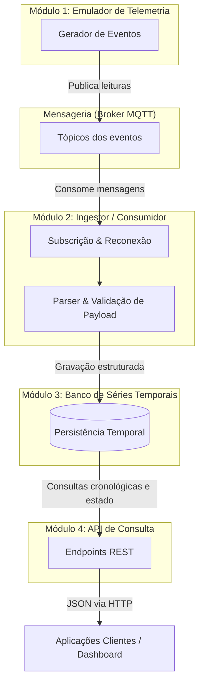

# Projeto Integrado: Sistema de Ingestão e Consulta de Séries Temporais via MQTT

Projeto integrado desenvolvido para disciplina do curso de Engenharia da Computação

## 1. Descritivo Funcional do Projeto

O projeto consiste em um sistema de software para captura, persistência estruturada e disponibilização de dados telemétricos emitidos por dispositivos em rede. 

O sistema opera em quatro módulos/etapas:
1. **Emissão de Eventos:** emuladores de teste, que transmitem leituras periódicas e eventos de estado utilizando o protocolo de mensageria MQTT.
2. **Ingestão Assíncrona:** Um serviço que consome as mensagens publicadas nos tópicos de interesse, validando a estrutura dos dados e registra os dados em uma base de dados.
3. **Persistência Temporal:** Os dados validados são gravados em uma base de dados especializada no armazenamento de séries temporais (*time-series*), garantindo ordenação cronológica e indexação eficiente por identificador de dispositivo.
4. **Disponibilização e Consulta:** Uma interface de API provê acesso estruturado aos dados, permitindo consultar o estado operacional mais recente de cada dispositivo, bem como resgatar históricos com filtros temporais para análise.

## Diagrama de Blocos da Arquitetura

---

## 2. Módulos do Sistema

A arquitetura do sistema é dividida em quatro módulos funcionais e desacoplados:

### 2.1. Módulo Emulador de Telemetria
* **Função:** Simular o comportamento de fontes de dados no ecossistema sem dependência de hardware físico.
* **Descrição:** 
  * Gera dados sintéticos em intervalos configuráveis com carimbo de tempo (*timestamp*).
  * Simula dois perfis de dispositivos: sensores (grandezas contínuas/acumulativas) e atuadores (estados discretos e tempos acumulados de operação).
  * Publica as mensagens nos respectivos tópicos do broker MQTT para validação ponta a ponta do pipeline.

### 2.2. Módulo Ingestor / Consumidor
* **Função:** Intermediar a camada de transporte de mensagens e a camada de armazenamento.
* **Descrição:**
  * Mantém a conexão ativa com o broker MQTT e subscreve aos tópicos monitorados.
  * Realiza a extração dos identificadores de dispositivos a partir dos tópicos.
  * Executa o parsing e a validação do esquema das mensagens (JSON), descartando ou tratando cargas malformadas.
  * Encaminha os registros íntegros para a rotina de escrita no banco de dados.

### 2.3. Módulo de Armazenamento de Séries Temporais
* **Função:** Garantir a persistência persistente, ordenada e otimizada dos eventos.
* **Descrição:**
  * Modela e gerencia tabelas dedicadas para eventos de sensores e de atuadores.
  * Aplica particionamento e indexação por tempo e identificador de dispositivo para responder com baixa latência a buscas por janelas cronológicas.
  * Mantém a integridade e histórico de telemetria para auditoria e relatórios.

### 2.4. Módulo de API de Consulta
* **Função:** Expor os dados persistidos de forma segura e padronizada para clientes externos.
* **Descrição:**
  * Disponibiliza rotas HTTP para listar os dispositivos com histórico registrado.
  * Provê endpoints para consultar o último estado conhecido de um dispositivo específico.
  * Implementa parâmetros de busca para extração de séries temporais com filtros de data inicial, final e paginação.
  * Retorna respostas estruturadas em formato JSON, acompanhadas de rotas de diagnóstico de integridade (*health check*).